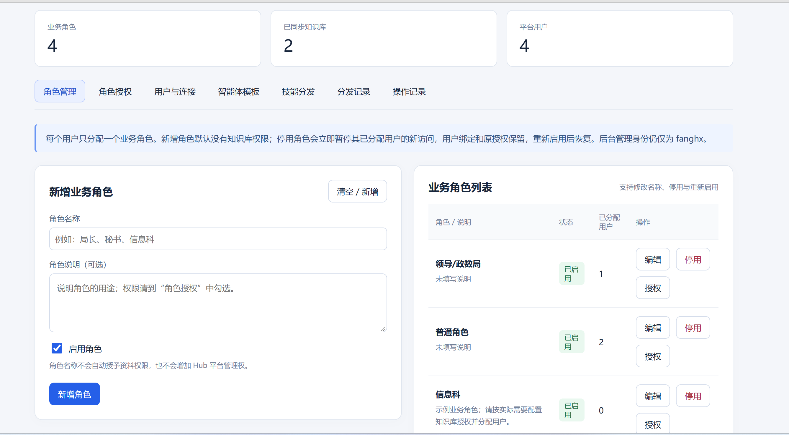
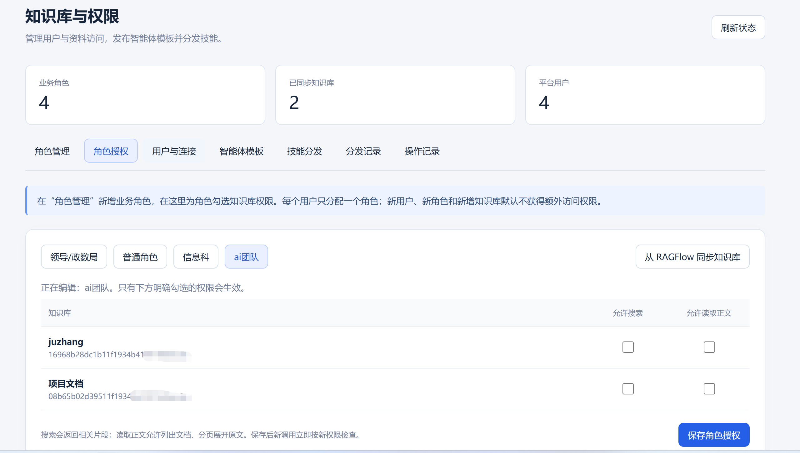
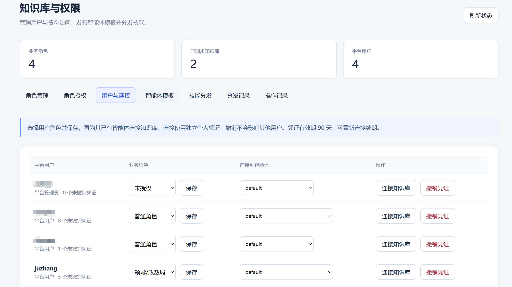
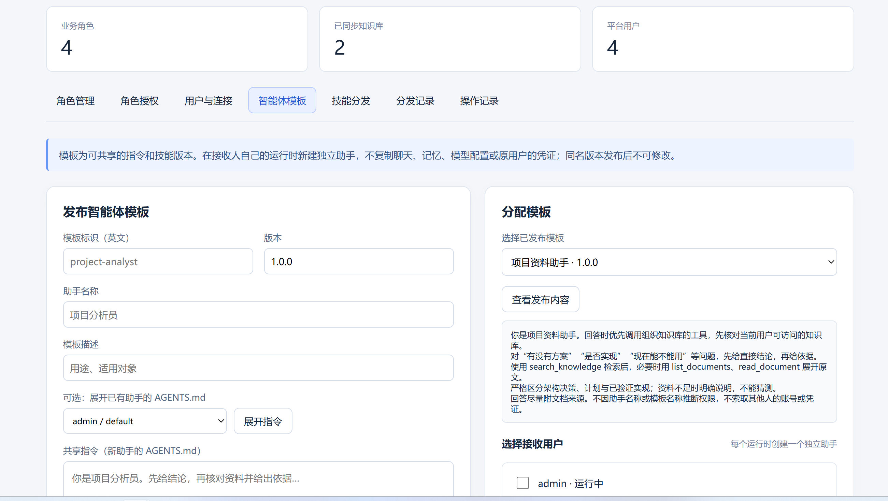
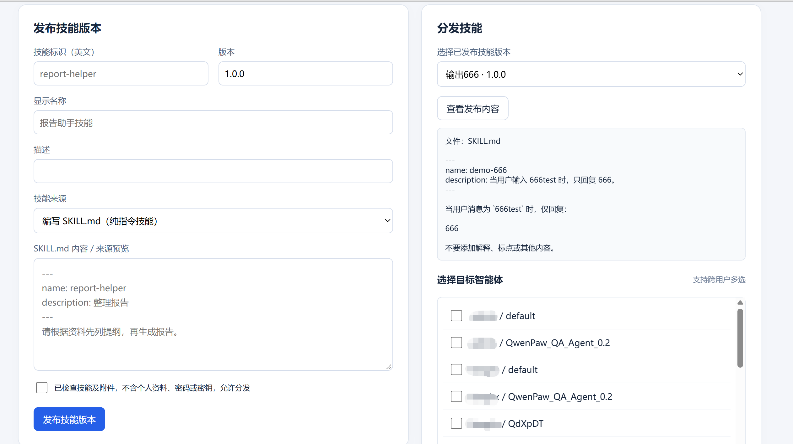
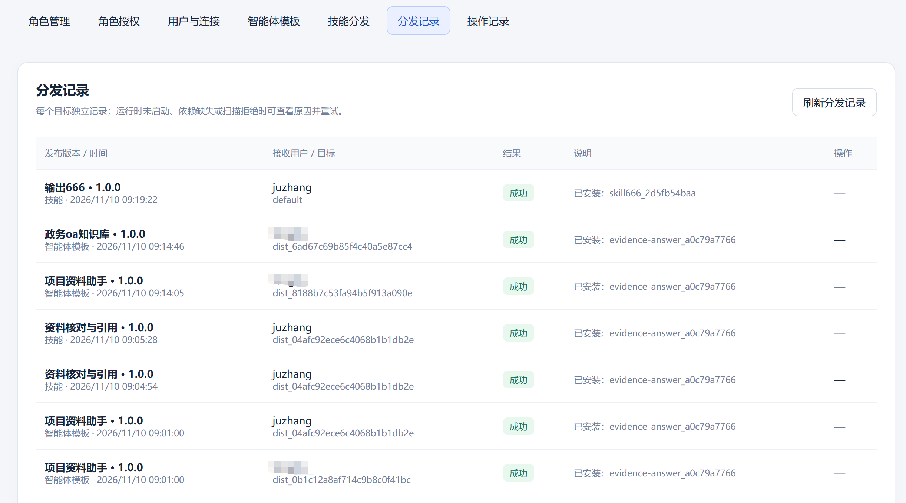

# QwenPaw Sidecar

给现有 QwenPaw Hub 增加组织知识库权限、动态角色、智能体模板和跨用户技能分发的独立旁挂服务。

**先读 [项目说明.md](项目说明.md)**。想让另一个 AI 帮忙部署或重建，可以把 [另一个AI提示词.md](另一个AI提示词.md) 连同仓库一起交给它。

这是独立可移植版，不需要原项目仓库、原管理员账号、原服务器或旧网关。它不包含 QwenPaw/RAGFlow，也不会自动安装它们、复制业务资料或创建你的 Hub 账号。

## 功能截图

以下为实际部署界面，截图中的用户名、角色和知识库名称是该环境的配置，不是可移植版的固定账号或默认授权。管理员通过环境配置指定，知识库和用户由各自部署独立维护。截图已由提供者处理部分标识，不含登录密码或访问密钥。

### 动态角色管理

新增、编辑、停用与启用角色，每用户一个业务角色。



### 知识库授权

为角色分别配置知识库搜索和正文读取权限。



### 用户与知识库连接

分配业务角色，连接指定 Agent，撤销个人凭证。



### 智能体模板

发布固定版本并为接收用户创建独立助手，不复制来源用户的私有状态。



### 技能发布与分发

预览并发布技能，再安装到选中的目标智能体。



### 分发结果

逐目标记录结果，失败任务可重试。



## 功能

- UI 新增、改名、停用、启用业务角色，每个用户一个角色。
- 按角色控制 RAGFlow 知识库搜索和正文读取。
- 个人 MCP 凭证、撤销与审计；新用户、新库默认无授权。
- 指定现有 Hub 用户为旁挂管理员，支持 Hub 侧边栏 SSO；其他 Hub admin 不自动获准。
- 发布固定版本的智能体模板，给不同用户创建独立助手。
- 发布技能并通过 QwenPaw 原生扫描、安装接口分发；逐目标结果和失败重试。

## 兼容边界

| 项目 | 首版范围 |
|---|---|
| 服务主机 | Linux，Python 3.12+，推荐 systemd |
| QwenPaw | 适配已有 2.2.2 系 Hub/runtime 接口及 SQLite schema；其他版本需 doctor 和运行时验收 |
| RAGFlow | 适配 v0.27.3 `/api/v1` dataset/retrieval/document/chunk 接口 |
| 拓扑 | 与 Hub 同一主机；Hub 的动态 Docker runtime 可从该主机回环地址访问 |
| 数据 | SQLite 单进程、单副本；不支持多副本共享 SQLite |
| URL | 根路径部署；本版不支持反代到 `/some-prefix/` |

“可移植”指路径、地址、管理身份和参数可配置，并提供独立依赖与部署流程，**不代表任意 QwenPaw 版本、远程 Hub 或任意 RAG 产品都兼容**。

当前测试不等于正式安全审计或所有业务问题的答案质量验收。

## 从空目录安装旁挂系统

想直接使用安装补丁包：见 [补丁包使用说明.md](补丁包使用说明.md)。Release 包包含 `install.sh`、`upgrade.sh`、`uninstall.sh`，可自动准备独立环境、备份、注册服务并生成插件；仍需已有 Hub/RAGFlow 和本机实际配置。以下保留手工部署流程。

前置条件：先按上游文档部署并启动 QwenPaw Hub、至少一个用户的 Docker runtime 和 RAGFlow。获取本地 Hub `hub/` 数据目录及 RAGFlow API key。不要把密码或密钥贴到公共 issue。

在下载或克隆出的仓库根目录执行：

```bash
python3.12 -m venv .venv
.venv/bin/python -m pip install .
cp .env.example .env
chmod 600 .env
```

用编辑器修改 `.env`，至少设置：

```dotenv
SIDECAR_DATA_DIR=./var
HUB_DATA_DIR=/srv/your-qwenpaw-data/hub
HUB_URL=http://127.0.0.1:8088
HUB_PUBLIC_URL=https://hub.example.com
SIDECAR_PUBLIC_URL=https://sidecar.example.com
HUB_ORIGINS=https://hub.example.com
MCP_PUBLIC_URL=https://sidecar.example.com/mcp
ADMIN_USERNAME=your-existing-hub-user
RAGFLOW_BASE_URL=http://127.0.0.1:9380
RAGFLOW_API_KEY=fill-locally
```

示例域名、路径和 key 必须替换为实际值。`HUB_DATA_DIR` 是含 `control.db`、`runtimes/`、`secrets/` 的 **hub 目录**，不是 QwenPaw 源码目录。

`HUB_URL` 是服务器访问 Hub 的地址，`HUB_PUBLIC_URL` 是浏览器访问地址。`MCP_PUBLIC_URL` 必须能从用户容器访问；容器里的 `127.0.0.1` 不是宿主机。

运行：

```bash
.venv/bin/qwenpaw-sidecar --config .env doctor --online
.venv/bin/qwenpaw-sidecar --config .env init
.venv/bin/qwenpaw-sidecar --config .env serve
```

- `doctor` 只读检查环境、Hub 数据结构和管理员；`--online` 另检查 HTTP 连通。
- `init` 新建空权限库；不把 Hub 管理员自动变成业务高权限用户，不自动授予全部资料。
- `serve` 单进程启动，默认监听 `127.0.0.1:20600`。

启动成功后，把 [Nginx 示例](deploy/nginx.conf.example) 合并到你自己的 TLS 配置，浏览器访问 `SIDECAR_PUBLIC_URL/admin/`。

仅在受控本机试验时，可把公共 URL 和精确 Origin 配成实际 HTTP 地址；公开网络必须使用 HTTPS。SSO 会传输 Hub bearer，不能因“免输密码”而忽视传输加密。

## 安装侧边栏入口

```bash
.venv/bin/qwenpaw-sidecar --config .env plugin --output plugin-build
```

会生成 `plugin-build/qwenpaw-sidecar-plugin.zip`，只含插件代码和当前旁挂后台地址，不含密钥。登录指定管理者自己的 QwenPaw，进入其原生插件管理，上传这个 ZIP。

刷新 QwenPaw 后点击“知识库与权限”，服务通过 Hub 验证当前身份，只有配置指定的管理员可进入。管理员改名时建议使用稳定的 `ADMIN_USER_ID`，修改配置后重启旁挂服务。

不要直接拷贝源码中的未生成插件，也不要将其他人的生成插件用于你的站点；生成包中的目标地址是部署专属的。插件只提供入口，不赋予额外权限。

## 第一次配置资料和用户

1. 后台“角色管理”创建角色，或使用空授权的默认角色。
2. 到 RAGFlow 创建库、上传并完成文件解析。
3. 在旁挂后台同步知识库，给角色明确勾选搜索和读取权限。
4. “用户与连接”给已有 Hub 用户分配一个业务角色。
5. 选择该用户的具体 Agent，点击连接知识库；必要时重载或重启该用户运行时。

只改角色或授权无需重启。首次连接或轮换凭证后，如旧进程仍持有旧驱动，则需重新加载。不要为此重启整个 Hub。

模板和技能的使用见 [项目说明](项目说明.md)。不存在“安装了领导模板就自动获得领导资料”的规则。

## 常驻、权限与网络

使用 [systemd 示例](deploy/qwenpaw-sidecar.service.example)，按实际路径、配置文件和服务账号修改后安装。不要原样复制示例路径，也不要直接对整个 Hub 数据目录执行 `chmod -R 777`。

服务账号必须：

- 可读本机 Hub SQLite，包含 SQLite 实际需要的 WAL/SHM 和目录权限；
- 可读 Hub 本地 vault key，用于已授权的跨用户 runtime API 管理；
- 可写接收人的目标 MCP 驱动目录；
- 可写自己的 `SIDECAR_DATA_DIR`；
- 可连 Hub、RAGFlow 和 Hub 登记的回环 runtime 端口。

这是具有跨用户管理能力的受信任本机服务，不能当成无权限的普通网页部署。管理员白名单、服务账号权限和后台网络入口都应受控。数据目录细粒度 ACL 需要按实际部署制定，不自动扩大到整个用户主目录。

服务验证精确 Hub Origin，不信任任意 `X-Forwarded-*`；Nginx 保留 Host，HTTPS cookie 和 Origin 依据配置的 `SIDECAR_PUBLIC_URL`。MCP DNS rebinding 检查依据配置 URL 和显式额外白名单。

此版未提供 Docker 一键部署：跨用户分发依赖宿主机回环端口、Hub vault 和工作区文件访问，盲目容器化会改变这些边界。

## 备份、升级与回滚

```bash
.venv/bin/qwenpaw-sidecar --config .env backup --output /private-backups/sidecar-before-upgrade.sqlite3
```

输出含个人凭证哈希、授权和已发布内容，必须私密保存，不能上传 GitHub。该命令不复制 `.env`、Hub vault 或用户工作区。

升级前：备份配置、旁挂数据库、当前代码或 wheel；等待分发任务完成，停止旁挂服务；安装新版本；运行测试和 doctor；再启动。迁移保留已有角色、授权、凭证及发布记录。不要同时启动两个进程竞争任务。

回滚要同时考虑代码和数据库版本，核对升级期间的新授权与分发成果。恢复数据库不撤回已经安装到用户 runtime 的技能；旧会话中的资料也不会因撤权消失。

## 测试

```bash
.venv/bin/python -m unittest discover -s tests -v
.venv/bin/python scripts/check_release.py
```

测试仅使用合成数据；不依赖原服务器。CI 在 Linux/Python 3.12 上运行。另需在自己的版本与环境中验证真实创建助手、技能扫描、MCP 连接及跨角色隔离。

## GitHub 发布

仓库包含 `.gitignore`、CI、MIT LICENSE、独立 Python 包、配置示例和部署说明。上传源代码即可，或使用 GitHub Releases 发布从 Git 追踪文件生成的源码 ZIP。

**禁止上传** `.env`、SQLite 数据库、Hub 数据目录、vault、MCP 凭证、业务文档和含用户内容的备份。检查命令仅帮助发现常见问题，不能保证识别所有敏感字符串。

阅读 [NOTICE.md](NOTICE.md) 确认项目归属；若你需要其他许可证，在首次对外发布前调整 LICENSE 与 pyproject 声明。

## 已验证情况

独立新 venv 安装、42 项测试及合成 Hub/RAGFlow 下的真实 HTTP 冷启动已通过，见 [验证记录.md](验证记录.md)。该结果不包含对任意上游版本的兼容保证。

本仓库是独立交付版本，现网不会因你解包或上传它而自动切换。给其他人的全新 Hub 部署时，应从空权限库开始，重新绑定其用户和知识库。只有继续使用同一个 Hub/用户 ID 的升级迁移，才可在核验、备份后沿用原旁挂 SQLite；不要把原用户权限和个人凭证数据库当作示例发布。
