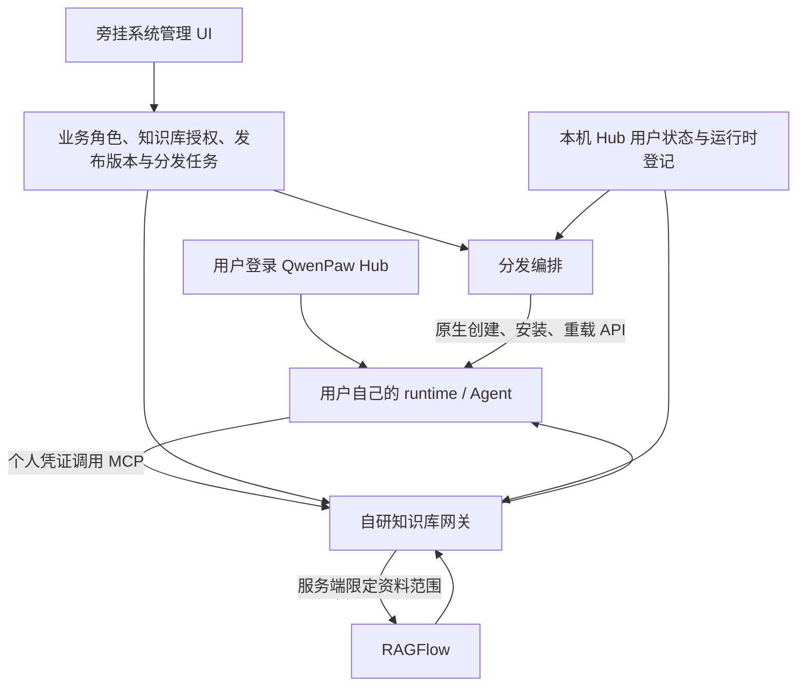

# 项目说明：QwenPaw 旁挂系统管理

## 一、这个项目解决什么问题

QwenPaw Hub 提供平台账号和每用户独立运行时，但本项目适配版本中没有完整的组织业务角色、跨用户知识库授权和管理员批量分发能力。

本仓库通过独立服务补齐这些功能。保留上游底座，调用既有 API，在本机管理边界内使用 Hub 身份和运行时接口，不要求为这些业务能力深改 QwenPaw。

本仓库不附带真实业务数据，不包含 QwenPaw/RAGFlow 部署物，不绑定任何个人管理员或服务器。

## 二、组件分工

| 组件 | 负责内容 |
|---|---|
| QwenPaw Hub | 平台账号、原生 admin/user、用户 runtime 生命周期 |
| 旁挂后台 | 业务角色、用户角色绑定、知识库操作授权、模板与技能发布、任务与审计 |
| MCP 网关 | 验证个人凭证、检查当前用户与角色、过滤资料范围 |
| RAGFlow | 资料上传、解析、知识片段、索引和检索 |
| 分发编排 | 为用户创建独立助手、安装技能、记录每目标结果和重试 |

## 三、功能与规则

### 1. 动态角色

支持新增、改名、说明、停用、启用；每用户一个业务角色。

新安装提供两个可改名、可停用的默认角色，默认没有任何资料权限。新用户不自动分配角色。

角色停用保留用户绑定和授权，但阻止新访问及签发新知识库凭证；启用后按现有规则恢复。已撤销、过期或因账号失效的凭证不会自动复活。

角色叫“领导”“财务”不会自动产生资料权限。部门范围、组织继承、秘书委托和每人多角色不在本版范围。

### 2. 知识库授权

角色和知识库是多对多关系，操作至少分：

- 搜索：模型可以得到授权库的检索片段和来源。
- 读取：列出文档并展开正文。

“只有搜索权限”不等于能隐藏检索片段本身。原文预览、下载等未来入口必须沿用授权，不能发出绕过权限的永久公开链接。

每个 Agent 连接知识库时获得接收用户自己的受限凭证。后端 RAGFlow 服务密钥不交给模型或用户。

现有其他 MCP、WeKnora、网页分享或 RAGFlow 账号不自动受这个网关控制，需另行确定权限边界。

### 3. 管理身份和 SSO

部署者通过 `ADMIN_USERNAME` 或 `ADMIN_USER_ID` 指定一个已有的 Hub 账号。后台许可独立于 Hub admin/user 和业务角色。

插件从已登录的 Hub 获取 bearer，向精确 Origin 白名单的票据接口请求 60 秒一次性票据；后台兑换成 HttpOnly 管理会话。票据通过 URL fragment 暂时传递，兑换前从浏览器地址移除，不写 query 或业务日志。

没有匿名免密入口，不会复制用户密码。账号禁用或登录态失效时拒绝进入。HTTPS 是必要的传输保护，短时票据不能替代 TLS。

### 4. 智能体模板

模板包含：显示名称、描述、显式发布的 AGENTS.md 指令、固定技能版本依赖、是否接入组织知识库。

可展开来源助手的 AGENTS.md 供管理员检查，但不复制其 Agent 配置、模型密钥、邮件账号、MCP Token、聊天、记忆、文件、任务。

分配给用户时在其 runtime 中新建独立助手，模型与安全设置由接收环境初始化。知识库按接收用户身份配置；模板不提升用户角色。

每次新的分配创建一个助手。失败应重试原任务，避免手动再次分配造成多份助手。

### 5. 技能分发

支持编写 SKILL.md，或从已有 Agent 选择技能并预览发布。允许的源文件范围为 SKILL.md、scripts/、references/、assets/；拒绝路径穿越、符号链接、隐藏附件及已知密钥文件。

这不是全自动脱敏：脚本或 Markdown 仍可能包含业务内容和密钥，发布者必须审阅。

通过目标 runtime 的原生 ZIP 安装和安全扫描，使用版本专属安装名，不覆盖用户自有同名技能。安装技能不会自动授予它所依赖的外部服务权限。

### 6. 版本、任务和审计

发布版本不可原地改内容，新内容用新版本。

每目标独立记录等待、执行中、成功或失败；重复提交去重，失败按持久化阶段重试。目标未启动时失败待重试，不自动停止其他用户。若检测到用户修改了待覆盖内容则拒绝覆盖。

不支持自动强制升级、远程擦除用户已复制的技能代码、多副本并发编排。审计记录操作者、动作、资源和结果，不默认记录完整问题或文档正文。

## 四、存储与文件

旁挂服务使用自己的 SQLite：

| 表 | 内容 |
|---|---|
| roles | 动态角色名称、状态、编辑版本 |
| subjects | 用户与单一角色绑定 |
| datasets / grants | 知识库登记与角色操作授权 |
| credentials | 个人凭证哈希、有效期及撤销状态 |
| audit | 管理操作与受控访问记录 |
| asset_releases | 不可变模板/技能发布版本 |
| distribution_jobs | 每个目标的分发进度与结果 |
| rbac_migrations | 数据迁移标记 |

文件默认在 `SIDECAR_DATA_DIR/data/permissions.sqlite3`，可配置。

QwenPaw Hub 的 SQLite、vault 和用户工作区是另一套数据。旁挂只读 Hub 表，不直接写 Hub 账号表；通过官方 runtime API 创建助手和安装技能。MCP 驱动按指定用户目录安全写入。

## 五、可移植性设计

通过环境变量或 `.env` 配置数据路径、Hub/RAGFlow URL、管理员、Origin、MCP Host 白名单、端口和凭证有效期。

插件由 CLI 按部署地址生成，前端跳转使用公开配置。配置里的本机 HTTP 地址、浏览器地址、容器访问地址可以不同，不要混用。

提供独立 Python 安装、doctor、初始化、启动、插件生成、SQLite 备份、systemd 和 Nginx 示例。

**运行时管理部分仍依赖当前 QwenPaw 2.2.2 系的 SQLite schema、vault 规则和原生 API。** 这是一层明确的版本适配，不是完全无耦合。其他版本需修改/验证 `hub.py` 和 `runtime_api.py`。

## 六、代码地图

| 路径 | 用途 |
|---|---|
| src/knowledge_rbac/config.py | 环境配置、URL 和白名单校验 |
| cli.py | 安装检查、初始化、启动、插件生成和备份 |
| store.py | 权限存储、角色与迁移 |
| server.py | MCP、后台 API、SSO、前端页面 |
| hub.py | Hub 账号和工作区适配 |
| runtime_api.py | 本机运行时 API 认证适配 |
| assets.py | 发布版本、分发任务和阶段重试 |
| static/index.html | 原生 HTML/JS 后台，无需 Node 构建 |
| plugin/ | QwenPaw 官方扩展 API 入口 |
| tests/ | 合成数据自动化测试 |
| deploy/ | systemd、TLS 反代示例 |

## 七、验收标准

1. 空白旁挂数据目录可初始化，不需要原服务器的数据或旧网关。
2. 指定管理员可通过 SSO 进入，其他用户和未指定的 Hub admin 不可进入。
3. 新用户、角色、库默认拒绝；角色 A/B 只能访问各自明确授权的库。
4. 停用角色或撤销个人凭证后，旧 Token 的后续请求被拒绝。
5. 改名保留绑定和授权，每用户只保留一个角色。
6. 模板生成独立助手，技能安装保留扫描，不带来源用户的私有状态。
7. 离线与部分失败可重试，不覆盖用户修改。
8. 新环境运行测试与 doctor，再做本机真实版本的 UI 和 runtime 接入验收。
9. GitHub 发布不含凭证、数据库、业务数据；源码检查与人工检查都通过。

## 八、后续演进

可逐步增加部门范围、多角色、委托、按角色自动配发、用户修改冲突处理、数据库服务化和支持更多检索后端。

这些不是本版已交付能力。新增能力应分别制定身份边界、权限规则、迁移策略和验收，而不是只增加一个 UI 名称。
